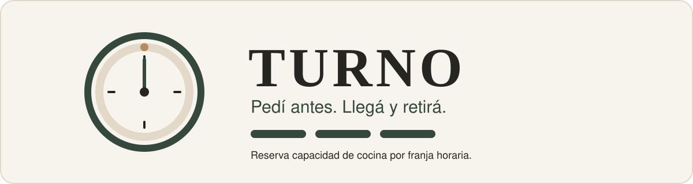
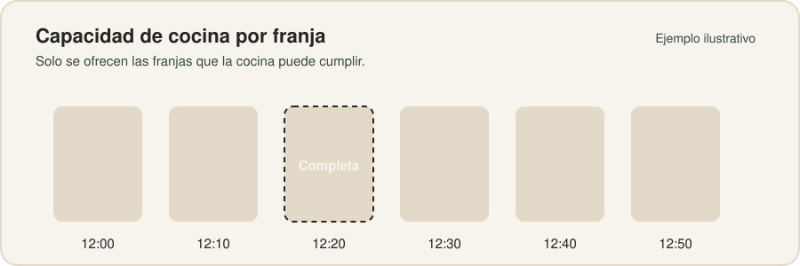

 

**Tu receso dura 30 minutos. La fila y la cocina se llevan 20.**

TURNO no reserva un pedido: reserva **capacidad de cocina**.
Por eso puede prometerte una hora de retiro y cumplirla.

 

[**Ver la demo en vivo**](https://turno-umber.vercel.app) · [Documentación](./docs) · [Decisiones de arquitectura](./docs/adr)

 

 

---

## Contenido

- [El problema](#el-problema)
- [Qué hace TURNO](#qué-hace-turno)
- [Cómo decide la cocina](#cómo-decide-la-cocina)
- [Para quién](#para-quién)
- [Tres pantallas, tres oficios](#tres-pantallas-tres-oficios)
- [Lo que TURNO no hace](#lo-que-turno-no-hace)
- [Calidad](#calidad)
- [Stack](#stack)
- [Documentación](#documentación)
- [Estado](#estado)

## El problema

En un campus, todo el mundo tiene hambre a la misma hora. La cocina de la
cafetería no puede ir más rápido porque haya más gente en la fila: prepara lo
que prepara, y lo demás espera.

El resultado lo conoce cualquiera que haya estudiado: veinte de los treinta
minutos del receso se van en la fila, y quien no alcanza vuelve a clase sin
comer.

Las aplicaciones de pedidos no resuelven esto. Toman todos los pedidos que
lleguen y después reparten culpas cuando la comida no está lista, porque
ninguna sabe cuánto le queda a esa cocina.

## Qué hace TURNO

Trata la cocina como lo que es: **un recurso con capacidad limitada**, medida
en minutos de preparación por franja horaria.

Cuando alguien arma un pedido, el sistema no pregunta "¿a qué hora lo querés?".
Calcula en qué horas esa cocina **puede cumplir de verdad** y solo ofrece esas.
Si una franja está comprometida, no aparece. Si el reloj ya no da tiempo para
preparar el plato antes de que la franja cierre, tampoco.

De ahí sale la única promesa del producto, y es una promesa que se puede
sostener:

> **Tu comida va a estar lista a la hora que dice.**

El estudiante sigue en clase mientras se prepara, llega, muestra un código,
paga en el mostrador y se va. Sin fila.

## Cómo decide la cocina

 

| Paso | Qué ocurre |
|---|---|
| 1. Se arma el pedido | El sistema suma los minutos de cocina que exige cada plato. |
| 2. Se calculan las franjas | Solo quedan las que tienen capacidad libre y tiempo de preparación. |
| 3. Se reserva | La reserva bloquea la capacidad de forma atómica. Dos personas no pueden tomar el último lugar. |
| 4. Se prepara | La cocina ve el pedido ordenado por urgencia real. |
| 5. Se retira | El estudiante muestra un código y paga en el mostrador. |

## Para quién

| | |
|---|---|
| **Estudiante** | Recupera su receso. En vez de hacer fila veinte minutos, llega cuando su comida está lista. |
| **Comercio** | Deja de perder ventas por gente que se va al ver la fila, y su cocina trabaja repartida en el tiempo en vez de colapsada en un pico. |
| **Campus** | Menos aglomeración en el mismo lugar a la misma hora. |

## Tres pantallas, tres oficios

- **El estudiante** ve qué hay, cuánto tarda y en qué horas puede retirar. Elige y recibe un código.
- **La cocina** ve una fila ordenada por urgencia real, no por orden de llegada, y marca cada pedido cuando sale.
- **La administración** ve la carga por franja, el cumplimiento y dónde se está formando el próximo cuello de botella.

## Lo que TURNO no hace

Decirlo por adelantado evita la sorpresa en el mostrador, que es donde una
sorpresa cuesta caro.

- **No se paga en línea.** El pago va en el mostrador, al retirar.
- **No hay entrega a domicilio.** Vos vas y retirás.
- **No promete horas que no puede cumplir.** Si la cocina no tiene lugar, el sistema rechaza el pedido y ofrece la primera hora con espacio, en vez de aceptar y fallar después.
- **No vive en las tiendas de aplicaciones.** Es una aplicación web instalable: funciona en el teléfono, la tablet y la computadora sin que nadie descargue nada.

## Calidad

| | |
|---|---|
| Pruebas unitarias y de integración | 701 |
| Pruebas de extremo a extremo | 73, en tema claro y oscuro |
| Cobertura del núcleo | 96.73 % |
| Cambio de diseño acumulado (CLS) | 0 |
| Latencia P95 bajo carga | 110 ms |
| Decisiones de arquitectura registradas | [ADR](./docs/adr) |
| Análisis de seguridad | CodeQL y Dependabot en CI |

## Stack

| Capa | Tecnología |
|---|---|
| Interfaz | Next.js, React, Tailwind CSS, PWA instalable |
| Núcleo de dominio | TypeScript puro en `src/core`, separado de la interfaz |
| Datos | PostgreSQL y Prisma |
| Validación | Zod |
| Pruebas | Vitest, Playwright, Stryker (mutación) |
| Infraestructura | Vercel y Neon ([ADR-18](./docs/adr/adr-18-infraestructura.md)) |

## Documentación

| Documento | Contenido |
|---|---|
| [`docs/desarrollo.md`](./docs/desarrollo.md) | Cómo levantar el entorno y trabajar en el código |
| [`docs/adr/`](./docs/adr) | Decisiones de arquitectura y sus alternativas |
| [`docs/requisitos.md`](./docs/requisitos.md) | Requisitos del producto |
| [`docs/design-system.md`](./docs/design-system.md) | Sistema de diseño |
| [`docs/mapa-pantallas.md`](./docs/mapa-pantallas.md) | Mapa de pantallas |
| [`audit/REPORT.md`](./audit/REPORT.md) | Informe de la auditoría técnica |

## Estado

Proyecto personal. Construido, probado y auditado.
Desplegado como demo en [turno-umber.vercel.app](https://turno-umber.vercel.app).
Todavía no opera con un comercio real.

 

---

*El detalle técnico, la arquitectura y cómo se levanta el entorno
están en [`docs/`](./docs).*

